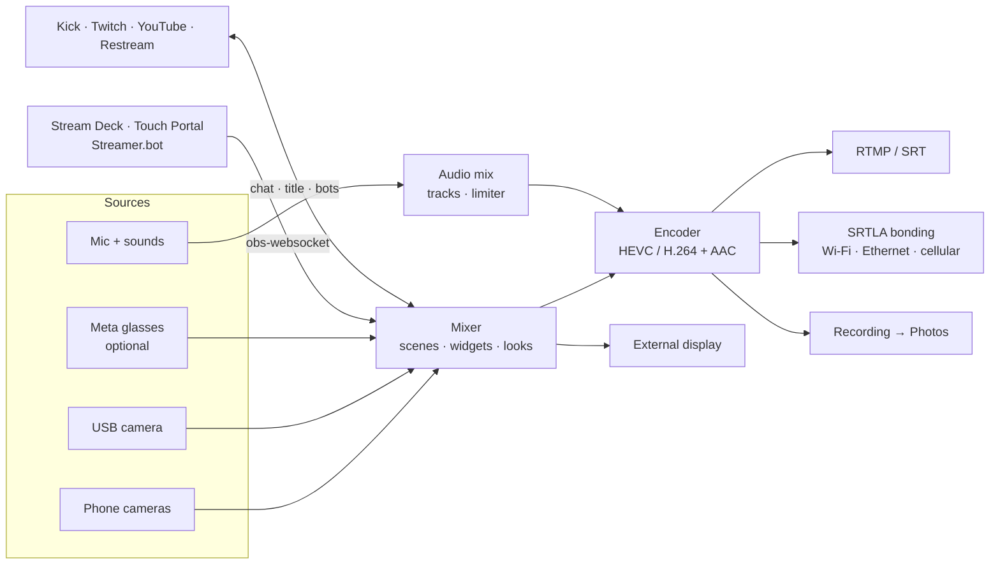

<p align="center">
  
</p>

<h1 align="center">MetaStream</h1>

<p align="center">
  A pocket OBS for IRL streamers. Scenes and widgets, a full audio mix, recording, bonded uplinks, chat with
  moderator commands and bots, and remote control from a Stream Deck, all on an iPhone or iPad.<br>
  Streams to Kick, Twitch, YouTube, Restream or any RTMP / SRT / SRTLA server. Meta glasses are an optional camera.<br>
  Built and signed from <b>Windows</b>. No Mac needed.
</p>

<p align="center">
  <a href="https://github.com/saeedkolivand/meta-stream/actions/workflows/build.yml"></a>
  
  
  
</p>

<p align="center">
  
  
  
</p>

---

## Why this exists

Desktop streamers get OBS: scenes, audio mixing, recording, a Stream Deck, bots. IRL streamers get a phone app that
pushes one camera and little else, plus a laptop-and-backpack rig for everything that app can't do. MetaStream puts
the OBS side of that rig on the phone: build scenes, mix sound, record, bond your connections and run chat from the
device you are already holding. It started as the missing app for Ray-Ban Meta glasses, which it still supports.

## What it does

### Cameras

| | |
|---|---|
| **Phone cameras** | Back or front, 720p or 1080p, portrait 9:16 or landscape 16:9, 24/30/60 fps, with lens, zoom, focus, exposure, HDR and stabilisation controls |
| **External camera** | A USB-C (UVC) camera such as a DJI Osmo Action shows up as a source on iPad |
| **Dual camera** | One camera full frame and a second as a small window; tap to swap |
| **Looks** | Brightness, contrast, saturation, warmth and `.cube` LUTs per camera |
| **Meta glasses (optional)** | Ray-Ban / Oakley Meta video through Meta's Device Access Toolkit, with automatic phone fallback when they drop. Off by default: turn on *Settings → Meta glasses* to show the glasses controls |

### Scenes and widgets

| | |
|---|---|
| **Scenes** | Build as many as you like, each with its own layers and optionally its own camera. Switch with a tap, rotate on a timer, or edit the live scene as a draft and apply it when ready |
| **Widgets** | Chat, alerts, event list, text with live tokens (`{time}`, `{uptime}`, `{viewers}`, `{bitrate}`, `{speed}`, `{city}`, `{weather}`, `{follower}`, `{sub}`, `{countdown}`, …), QR code, image / GIF, slideshow, video, and any web widget (StreamElements, Streamlabs) |
| **Scene roles** | Starting (with a countdown after you go live), BRB (switched to on its own while the connection is weak) and Ending. Ready-made Mono and Ticker sets add all three at once |
| **Stingers** | A transition clip that covers the switch between scenes |
| **OBS import** | Bring a scene collection over from OBS on your PC; PC-only sources are skipped and listed |
| **Privacy blur** | Blurs the picture on demand |
| **External display** | A clean program feed on a USB-C monitor |

### Audio

| | |
|---|---|
| **Mix** | Mic, alert sounds, soundboard and clip audio as separate tracks with their own volume, through a limiter |
| **Meter and dead-air alert** | A level bar on screen, and a warning when the mic goes silent while live |
| **Soundboard** | Your own sound files, one tap each |
| **Read aloud** | Chat and alerts spoken in your ear, with priority lanes so stream warnings interrupt and chat never piles up |

### Going live and staying live

| | |
|---|---|
| **Destinations** | Presets for Kick, Twitch, YouTube and Restream, plus Instagram, TikTok and any RTMP, RTMPS or SRT server |
| **SRTLA bonding** | Use an `srtla://` ingest and the stream is split across Wi-Fi, Ethernet and cellular at once, so one link dropping doesn't drop the stream |
| **Adaptive bitrate** | Backs off when the uplink struggles and climbs back quickly once it clears |
| **Reconnects** | Retries with backoff, speaks "stream dropped" and "stream back", and keeps the timer honest |
| **Health warnings** | Battery, thermal, dead air and connection state, spoken once each |
| **Background** | Keeps streaming while you check a message or open Maps; Picture in Picture keeps a re-encoded stream alive |
| **Recording** | Record to Photos with or without going live (HEVC, saved in fragments so a crash keeps what was recorded) |
| **Live Activity** | Stream state on the Lock Screen and Dynamic Island |

### Chat, moderation and bots

| | |
|---|---|
| **Chat** | Kick, Twitch, YouTube and Restream in one sheet over the preview, with 7TV / BTTV / FFZ emotes and badges |
| **Slash commands** | Type `/ban`, `/timeout`, `/clear`, `/slow`, `/followers`, `/emoteonly`, `/title`, `/category`, `/raid`, `/poll`, `/ad`, `/announce`, `/marker`, `/clip` and more, like in the platform's own chat |
| **Bot commands** | Saved commands for your chat bots as one-tap chips, also from the Lock Screen |
| **App bot** | The app's own bot posts scene notices, answers viewer commands such as `!location`, runs timers and thanks new followers and subs (Kick and Twitch) |
| **Stream Manager** | Edit title and category, watch viewers, pull your stream key and switch Restream destinations |

### Remote control and extras

| | |
|---|---|
| **obs-websocket** | The app speaks the obs-websocket v5 protocol on your local network, so Stream Deck, Touch Portal and Streamer.bot control it as if it were OBS: switch scenes, go live, record, mute. Password protected, local network only |
| **GPS from iPhone** | A Wi-Fi-only iPad borrows the iPhone's location over Personal Hotspot for speed, distance, city and weather widgets |
| **Logs** | Every API call and stream event lands in *Settings → Diagnostics* with a share button. Keys and tokens are masked |

## How it works



One SwiftUI app on top of [HaishinKit](https://github.com/HaishinKit/HaishinKit.swift). There is no server: platform
tokens stay on the device. Design decisions are recorded in [`adr/`](adr) and the vocabulary in [`CONTEXT.md`](CONTEXT.md).

## Codec per destination

Tested against each ingest, not taken from marketing pages:

| Destination | Takes HEVC | What the app sends |
|---|---|---|
| Your own RTMP server | yes, if your server decodes it | HEVC |
| YouTube | yes, over enhanced RTMP | HEVC |
| Kick | no | H.264 |
| Restream over RTMP | no, only over SRT | H.264 |
| Any `srt://` or `srtla://` ingest | yes | HEVC |
| Twitch | Affiliates and Partners only | H.264 |
| Instagram, TikTok | no | H.264 |

Auto follows this table, and Settings lets you override it per stream.

## Limits you should know

- **Screen share isn't there yet.** It needs a broadcast extension and an App Group ([`adr/0003`](adr/0003-screen-arrives-encoded-like-the-glasses.md)).
- **Some Kick commands go through kick.com.** Kick's public API has no endpoint for `/clear`, `/slow`, `/poll` and a
  few others, so the app runs them through a signed-in kick.com page (*Settings → Chat commands*, [`adr/0005`](adr/0005-kick-slash-commands-through-the-website.md)).
- **Glasses**: 720×1280 portrait at 30 fps is the most Meta's SDK gives any third-party app, the glasses pick their
  own bitrate, their video can't carry overlays or be recorded unless it is re-encoded, and their battery level isn't
  readable. The glasses keep one third-party app registered at a time.
- **Background streaming without Picture in Picture** works only when the video isn't re-encoded.
- **A paid Apple Developer team** is required for the glasses. See [Why a paid Apple team](#why-a-paid-apple-team).

---

## Build your own copy

You need an iPhone or iPad on iOS 26.0+, a GitHub account, and access to a **paid Apple Developer team** (yours, or a
friend who exports a development certificate for you). Meta glasses and the Meta AI app are optional. No Mac is
required at any point: GitHub's macOS runners do the compiling.

### 1. Fork and rename

Fork this repo. Pick a bundle ID (**no hyphens**, Meta rejects them) and replace `com.saeedkolivand.metastream` in
`project.yml`, `MetaStream/Info.plist` and `MetaStream/Platforms/Platforms.swift`. Replace `metastream.iamsaeed.dev` in
`Platforms.swift` with your redirect page host (step 5).

### 2. Meta Wearables Developer Center (only for glasses)

Skip this step if you will not use Meta glasses: with no `META_APP_ID` the build hides every glasses control.


1. Sign up at <https://wearables.developer.meta.com> and create a project. Bundle ID = yours, Apple Team ID = the paid
   team's ID, Universal link = `metastream://`. Enable the **Camera** permission with a rationale.
2. Copy **MetaAppID** and **ClientToken** (shown under *Application ID*).
3. In the Meta AI app: *Settings → App Info → tap the version 5× → Developer Mode on*. Glasses firmware ≥ v126, Meta AI ≥ V282.

### 3. Apple signing (the paid-team part)

In <https://developer.apple.com/account> → Certificates, Identifiers & Profiles:

1. **Devices** → register your iPhone's UDID (`pip install pymobiledevice3` → `pymobiledevice3 usbmux list`).
2. **Identifiers** → App ID with your bundle ID; enable **Access Wi-Fi Information** and **Hotspot** (the glasses need both).
3. **Profiles** → *iOS App Development* profile for that App ID, your device, an Apple Development certificate → download.
4. Export that certificate **with its private key** from Keychain Access as a `.p12`.

### 4. Platform apps (optional, one per platform you want in Stream Manager)

| Platform | Where | Settings |
|---|---|---|
| Kick | kick.com → Settings → Developer (2FA required) | Redirect `https://<your-redirect-host>/oauth.html`, all scopes |
| Twitch | <https://dev.twitch.tv/console> | Redirect `http://localhost`, client type **Public** (device-code login, no secret) |
| Restream | <https://developers.restream.io/apps> | Redirect `https://<your-redirect-host>/oauth.html`, all permissions |
| YouTube | <https://console.cloud.google.com> | Enable *YouTube Data API v3*; OAuth consent screen (Testing, add yourself as test user); OAuth client of type **iOS** with your bundle ID |

### 5. Redirect page

Kick and Restream require an `https` redirect. `docs/oauth.html` is a static page that sends the browser back
into the app. Serve it with GitHub Pages (*Settings → Pages → Deploy from branch → `main` `/docs`*), optionally
behind a custom domain (add a `CNAME` record → `<you>.github.io`, **DNS only**).

### 6. Secrets

*Settings → Secrets and variables → Actions* in your fork:

| Secret | Value |
|---|---|
| `META_APP_ID`, `CLIENT_TOKEN` | from step 2; leave out for a build without glasses |
| `TEAM_ID` | the paid team's 10-character Team ID |
| `P12_BASE64`, `P12_PASSWORD` | `base64 -w0 cert.p12`, and its export password |
| `PROVISIONING_PROFILE_BASE64` | `base64 -w0 profile.mobileprovision` |
| `IPA_PASSWORD` | any long random string; encrypts the build artifact (public repo) |
| `KICK_CLIENT_ID`, `KICK_CLIENT_SECRET`, `TWITCH_CLIENT_ID`, `RESTREAM_CLIENT_ID`, `RESTREAM_CLIENT_SECRET`, `YOUTUBE_CLIENT_ID` | from step 4, only the ones you created |

### 7. Build and install (from Windows, Linux or macOS)

Push to `main` or run the *build-ipa* workflow. Once (Windows: run these in Git Bash, which ships `openssl`; the
*Apple Devices* app or iTunes provides the USB driver):

```bash
pip install pymobiledevice3
gh auth login
```

Then, every time, from the repo root with every phone/iPad unlocked and on USB:

```bash
gh run list -w build-ipa -L 1                    # wait until the newest run says "completed success"
rm -f build/MetaStream.ipa.enc build/MetaStream.ipa
gh run download -n MetaStream-ipa -D build       # newest artifact
openssl enc -d -aes-256-cbc -pbkdf2 -in build/MetaStream.ipa.enc -out build/MetaStream.ipa -pass file:signing/ipa-password.txt
for udid in $(pymobiledevice3 usbmux list --usb --simple | grep -oE '[0-9A-F]{8}-[0-9A-F]{16}'); do
  pymobiledevice3 apps install --udid "$udid" build/MetaStream.ipa && echo "OK $udid" || echo "FAILED $udid"
done
```

`signing/ipa-password.txt` holds the `IPA_PASSWORD` secret (or use `-pass pass:'<IPA_PASSWORD>'`). Each device must
print `OK`; `pymobiledevice3` reports errors on stderr, so don't pipe it into `tail`. If a device fails: unlock it,
tap *Trust* on it, replug, and rerun only the loop. `bad decrypt` means the wrong password file.

First launch: *Settings → General → VPN & Device Management → trust the developer*. The development profile is valid
for a year; rebuilds install over the previous version and keep your settings. A device must be in the profile
(step 3) or the install fails with a provisioning error.

---

## Using it

1. **Settings → Ingest & protocol** → pick a destination, or open **Manage**, connect a platform and tap *Use for
   streaming* to fill the URL, key and chat for you.
2. **Settings → Scenes & widgets** → *Add Starting, BRB & Ending scenes*, then add your own scenes and widgets.
3. **GO LIVE.** The source button picks the camera, the record button records, the chat button slides chat over the preview.
4. **Glasses:** *Settings → Meta glasses → Use Meta glasses*, then register with Meta AI from the card that appears.
5. **Stream Deck:** *Settings → Remote control* → set a password, then add the app in your OBS plugin as an OBS
   instance at the address shown.

## Why a paid Apple team

Since DAT SDK 0.8 the glasses send video over a direct Wi-Fi link. Joining it needs two entitlements,
`com.apple.developer.networking.HotspotConfiguration` and `com.apple.developer.networking.wifi-info`, which Apple only
grants to paid teams. A build signed with a free Apple ID (Sideloadly, AltStore) registers the glasses and connects
over Bluetooth but never receives a frame. This is Apple's rule, and the app can't work around it.

## Troubleshooting

| Symptom | Cause and fix |
|---|---|
| Glasses pill stuck on *connecting*, 0 frames | The build was signed with a free Apple ID and has no Wi-Fi entitlements. See above. |
| *Device unavailable* right after starting the glasses | An SDK bug ([#292](https://github.com/facebook/meta-wearables-dat-ios/issues/292)). The app retries three times on its own and usually connects on the second. If all three fail, toggle Bluetooth or reopen the Meta AI app. |
| *Internal error* during Meta registration | Reported on iPhone 17e with iOS 26.5.1 ([#205](https://github.com/facebook/meta-wearables-dat-ios/issues/205)). |
| Ingest accepts the connection, then closes it a second later | The destination refused the codec. Set the codec to H.264 in Settings, or leave it on Auto. |
| The channel stays offline although the app says live | Same cause. A server that finds no video while it probes the first seconds treats the session as audio only. |
| Your own relay or OBS shows nothing | Check the stream key is not empty, and that the server decodes HEVC. FFmpeg 6.1 and newer does. |
| The stream freezes when you leave the app | Only transcoded streams do this. Keep the Picture in Picture window open, or send HEVC to YouTube or your own relay. |
| Kick login opens the Kick app instead of the login page | A universal-link quirk. Long-press the link and open it in the browser, or try again. |

## Security notes

- The `signing/` folder (certificate, profile, client-ID files, IPA password) is gitignored. Never commit it.
- Build artifacts are encrypted because anyone with a GitHub account can download public-repo artifacts and the IPA
  embeds OAuth client secrets. Development-signed IPAs only install on the UDIDs in the profile anyway.
- Platform tokens and stream keys are stored in `UserDefaults` on the phone (single-user app). Move them to the
  Keychain if you share the device.

## Roadmap

Done: scenes and widgets, OBS import, audio mix and soundboard, recording, scene roles and stingers, obs-websocket
remote control, slash commands, App bot, Looks, SRTLA bonding, adaptive bitrate, read aloud, privacy blur.

Next: screen share, animated stingers for the scene templates, Android ([`adr/0002`](adr/0002-android-native-kotlin-port.md)).

## Credits

[HaishinKit](https://github.com/HaishinKit/HaishinKit.swift) ·
[Meta Wearables Device Access Toolkit](https://github.com/facebook/meta-wearables-dat-ios) ·
[BELABOX srtla](https://github.com/BELABOX/srtla) · [XcodeGen](https://github.com/yonaskolb/XcodeGen) ·
[pymobiledevice3](https://github.com/doronz88/pymobiledevice3) · [Vazirmatn](https://github.com/rastikerdar/vazirmatn).
Built by [Saeed Kolivand](https://iamsaeed.dev) with Claude Code.
