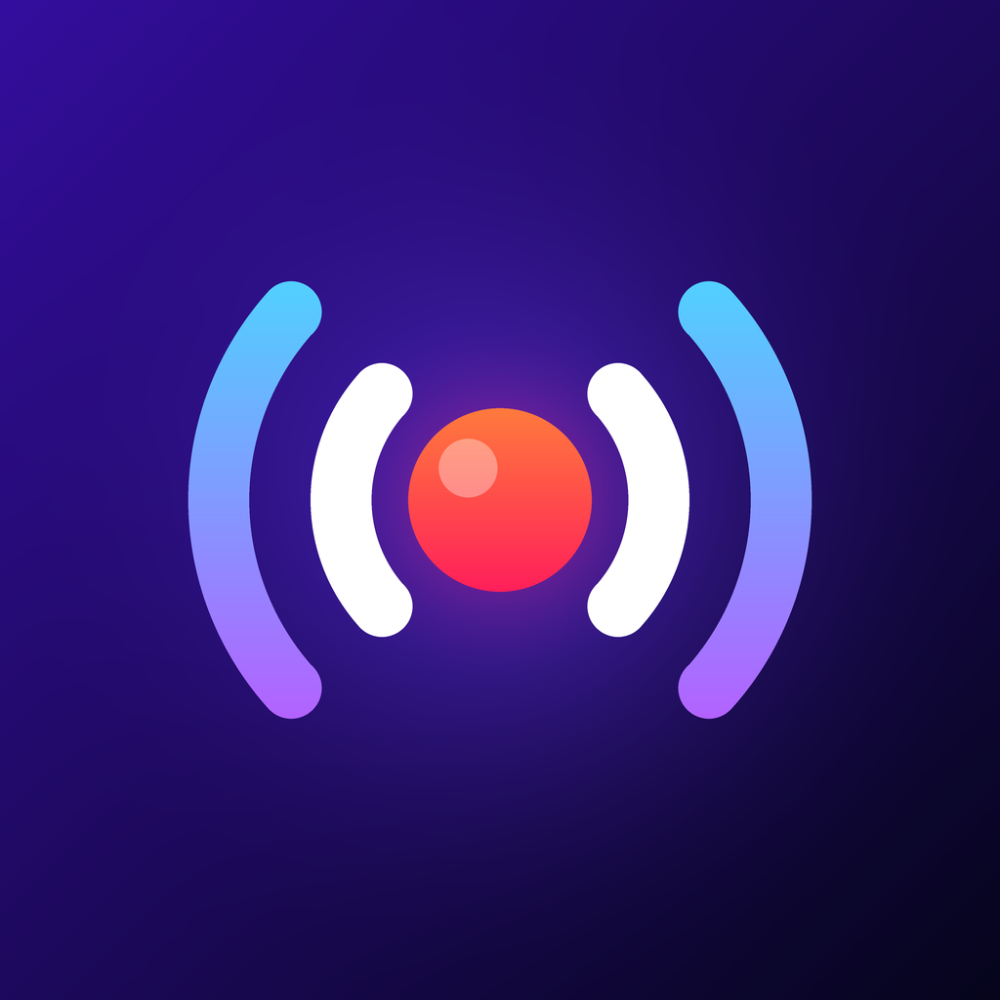

  

<h1 align="center">MetaStream</h1>

  A pocket OBS for IRL streamers. Scenes and widgets, a full audio mix, recording, bonded uplinks, chat with
  moderator commands and bots, and remote control from a Stream Deck, on <b>iPhone, iPad and Android</b>. 
  Streams to Kick, Twitch, YouTube, Restream or any RTMP / SRT / SRTLA server. Meta glasses are an optional camera. 
  Two native apps, built on GitHub Actions and installed from <b>Windows</b>. No Mac needed.

  
  
  
  
  
  
  

  
  
  

---

## Why this exists

Desktop streamers get OBS: scenes, audio mixing, recording, a Stream Deck, bots. IRL streamers get a phone app that
pushes one camera and little else, plus a laptop-and-backpack rig for everything that app can't do. MetaStream puts
the OBS side of that rig on the phone: build scenes, mix sound, record, bond your connections and run chat from the
device you are already holding, whether that is an iPhone, an iPad or an Android phone. It started as the missing app
for Ray-Ban Meta glasses, which it still supports on both platforms.

## Highlights

- **Scenes and widgets** with chat, alerts, live text tokens, QR codes, images and web widgets; Starting, BRB and Ending scenes switch on their own
- **Audio mix** with a soundboard, level meter and dead-air alert
- **Recording** to Photos, with or without going live
- **RTMP, SRT and SRTLA bonding** across Wi-Fi, Ethernet and cellular, with adaptive bitrate
- **Chat** for Kick, Twitch, YouTube and Restream, with `/slash` moderator commands and an app bot
- **Stream Deck control** over the obs-websocket protocol
- **Cameras**: phone, USB-C, dual camera, Looks and LUTs, and optional Meta glasses
- **Both platforms**: the iOS and Android apps have the same features, settings and names, so switching phones
  feels the same ([differences](guide/features.md#ios-and-android))

## Architecture

Both apps are native (Swift on iOS, Kotlin on Android) and split into the same feature modules: core (model, logging,
storage, network, UI), then Camera, Platforms, Chat, Goal, Speech, Privacy, Engine, Overlays, Bot, Reach and Remote,
with a thin app on top that holds the main screen, the settings catalog and the wiring. iOS keeps them as targets of
one local Swift package (`Packages/MetaStreamKit`), Android as Gradle modules (`android/core/*`, `android/feature/*`).
[ADR 0007](adr/0007-feature-modules-mirrored-across-platforms.md) has the rules.

## Docs

| | |
|---|---|
| [Features](guide/features.md) | Everything the app does, how to use it, codec per destination, limits |
| [Build your own copy](guide/build.md) | Fork, build on GitHub Actions and install from Windows: iOS (paid Apple team) or Android (no account needed) |
| [Troubleshooting](guide/troubleshooting.md) | Common problems and fixes |
| [Contributing](CONTRIBUTING.md) | Repo layout, module rules, the checks to run before a PR |
| [Design decisions](adr) | Why things are built the way they are |
| [Glossary](CONTEXT.md) | The words the code and docs use |

## Credits

[HaishinKit](https://github.com/HaishinKit/HaishinKit.swift) ·
[RootEncoder](https://github.com/pedroSG94/RootEncoder) ·
[Meta Wearables Device Access Toolkit](https://github.com/facebook/meta-wearables-dat-ios) ·
[BELABOX srtla](https://github.com/BELABOX/srtla) · [XcodeGen](https://github.com/yonaskolb/XcodeGen) ·
[pymobiledevice3](https://github.com/doronz88/pymobiledevice3) · [Vazirmatn](https://github.com/rastikerdar/vazirmatn).
Built by [Saeed Kolivand](https://iamsaeed.dev) with Claude Code.
