[← README](../README.md)

# Features

## Using it

1. **Settings → Ingest & protocol** → pick a destination, or open **Manage**, connect a platform and tap *Use for
   streaming* to fill the URL, key and chat for you.
2. **Settings → Scenes & widgets** → *Add Starting, BRB & Ending scenes*, then add your own scenes and widgets.
3. **GO LIVE.** The source button picks the camera, the record button records, the chat button slides chat over the preview.
4. **Glasses:** *Settings → Meta glasses → Use Meta glasses*, then register with Meta AI from the card that appears.
5. **Stream Deck:** *Settings → Remote control* → set a password, then add the app in your OBS plugin as an OBS
   instance at the address shown.

## What it does

### Cameras

| | |
|---|---|
| **Phone cameras** | Back or front, 720p or 1080p, portrait 9:16 or landscape 16:9, 24/30/60 fps, with lens, zoom, focus, exposure, HDR and stabilisation controls |
| **External camera** | A USB-C (UVC) camera such as a DJI Osmo Action shows up as a source on iPad |
| **Dual camera** | One camera full frame and a second as a small window; tap to swap |
| **Looks** | Brightness, contrast, saturation, warmth and `.cube` LUTs per camera |
| **Meta glasses (optional)** | Ray-Ban / Oakley Meta video through Meta's Device Access Toolkit, with automatic phone fallback when they drop. Off by default: turn on *Settings → Meta glasses* to show the glasses controls |

### Scenes and widgets

| | |
|---|---|
| **Scenes** | Build as many as you like, each with its own layers and optionally its own camera. Switch with a tap, rotate on a timer, or edit the live scene as a draft and apply it when ready |
| **Widgets** | Chat, alerts, event list, text with live tokens (`{time}`, `{uptime}`, `{viewers}`, `{bitrate}`, `{speed}`, `{city}`, `{weather}`, `{follower}`, `{sub}`, `{countdown}`, …), QR code, image / GIF, slideshow, video, and any web widget (StreamElements, Streamlabs) |
| **Scene roles** | Starting (with a countdown after you go live), BRB (switched to on its own while the connection is weak) and Ending. Ready-made Mono and Ticker sets add all three at once |
| **Stingers** | A transition clip that covers the switch between scenes |
| **OBS import** | Bring a scene collection over from OBS on your PC; PC-only sources are skipped and listed |
| **Privacy blur** | Blurs the picture on demand |
| **External display** | A clean program feed on a USB-C monitor |

### Audio

| | |
|---|---|
| **Mix** | Mic, alert sounds, soundboard and clip audio as separate tracks with their own volume, through a limiter |
| **Meter and dead-air alert** | A level bar on screen, and a warning when the mic goes silent while live |
| **Soundboard** | Your own sound files, one tap each |
| **Read aloud** | Chat and alerts spoken in your ear, with priority lanes so stream warnings interrupt and chat never piles up |

### Going live and staying live

| | |
|---|---|
| **Destinations** | Presets for Kick, Twitch, YouTube and Restream, plus Instagram, TikTok and any RTMP, RTMPS or SRT server |
| **SRTLA bonding** | Use an `srtla://` ingest and the stream is split across Wi-Fi, Ethernet and cellular at once, so one link dropping doesn't drop the stream |
| **Adaptive bitrate** | Backs off when the uplink struggles and climbs back quickly once it clears |
| **Reconnects** | Retries with backoff, speaks "stream dropped" and "stream back", and keeps the timer honest |
| **Health warnings** | Battery, thermal, dead air and connection state, spoken once each |
| **Background** | Keeps streaming while you check a message or open Maps; Picture in Picture keeps a re-encoded stream alive |
| **Recording** | Record to Photos with or without going live (HEVC, saved in fragments so a crash keeps what was recorded) |
| **Live Activity** | Stream state on the Lock Screen and Dynamic Island |

### Chat, moderation and bots

| | |
|---|---|
| **Chat** | Kick, Twitch, YouTube and Restream in one sheet over the preview, with 7TV / BTTV / FFZ emotes and badges |
| **Slash commands** | Type `/ban`, `/timeout`, `/clear`, `/slow`, `/followers`, `/emoteonly`, `/title`, `/category`, `/raid`, `/poll`, `/ad`, `/announce`, `/marker`, `/clip` and more, like in the platform's own chat |
| **Bot commands** | Saved commands for your chat bots as one-tap chips, also from the Lock Screen |
| **App bot** | The app's own bot posts scene notices, answers viewer commands such as `!location`, runs timers and thanks new followers and subs (Kick and Twitch) |
| **Stream Manager** | Edit title and category, watch viewers, pull your stream key and switch Restream destinations |

### Remote control and extras

| | |
|---|---|
| **obs-websocket** | The app speaks the obs-websocket v5 protocol on your local network, so Stream Deck, Touch Portal and Streamer.bot control it as if it were OBS: switch scenes, go live, record, mute. Password protected, local network only |
| **GPS from iPhone** | A Wi-Fi-only iPad borrows the iPhone's location over Personal Hotspot for speed, distance, city and weather widgets |
| **Logs** | Every API call and stream event lands in *Settings → Diagnostics* with a share button. Keys and tokens are masked |

## Codec per destination

Tested against each ingest, not taken from marketing pages:

| Destination | Takes HEVC | What the app sends |
|---|---|---|
| Your own RTMP server | yes, if your server decodes it | HEVC |
| YouTube | yes, over enhanced RTMP | HEVC |
| Kick | no | H.264 |
| Restream over RTMP | no, only over SRT | H.264 |
| Any `srt://` or `srtla://` ingest | yes | HEVC |
| Twitch | Affiliates and Partners only | H.264 |
| Instagram, TikTok | no | H.264 |

Auto follows this table, and Settings lets you override it per stream.

## Limits you should know

- **Screen share isn't there yet.** It needs a broadcast extension and an App Group ([`adr/0003`](../adr/0003-screen-arrives-encoded-like-the-glasses.md)).
- **Some Kick commands go through kick.com.** Kick's public API has no endpoint for `/clear`, `/slow`, `/poll` and a
  few others, so the app runs them through a signed-in kick.com page (*Settings → Chat commands*, [`adr/0005`](../adr/0005-kick-slash-commands-through-the-website.md)).
- **Glasses**: 720×1280 portrait at 30 fps is the most Meta's SDK gives any third-party app, the glasses pick their
  own bitrate, their video can't carry overlays or be recorded unless it is re-encoded, and their battery level isn't
  readable. The glasses keep one third-party app registered at a time.
- **Background streaming without Picture in Picture** works only when the video isn't re-encoded.
- **A paid Apple Developer team** is required for the glasses. See [Why a paid Apple team](build.md#why-a-paid-apple-team).

## How it works

```mermaid
flowchart LR
  subgraph Sources
    P[Phone cameras]
    U[USB camera]
    G[Meta glasses<br/>optional]
    M[Mic + sounds]
  end
  P & U & G --> X[Mixer<br/>scenes · widgets · looks]
  M --> AM[Audio mix<br/>tracks · limiter]
  X & AM --> E[Encoder<br/>HEVC / H.264 + AAC]
  E --> O[RTMP / SRT]
  E --> B[SRTLA bonding<br/>Wi-Fi · Ethernet · cellular]
  E --> R[Recording → Photos]
  X --> D[External display]
  SD[Stream Deck · Touch Portal<br/>Streamer.bot] -- obs-websocket --> X
  API[Kick · Twitch · YouTube · Restream] <-- chat · title · bots --> X
```

One SwiftUI app on top of [HaishinKit](https://github.com/HaishinKit/HaishinKit.swift). There is no server: platform
tokens stay on the device. Design decisions are recorded in [`adr/`](../adr) and the vocabulary in [`CONTEXT.md`](../CONTEXT.md).

## Roadmap

Done: scenes and widgets, OBS import, audio mix and soundboard, recording, scene roles and stingers, obs-websocket
remote control, slash commands, App bot, Looks, SRTLA bonding, adaptive bitrate, read aloud, privacy blur.

Next: screen share, animated stingers for the scene templates, Android ([`adr/0002`](../adr/0002-android-native-kotlin-port.md)).

